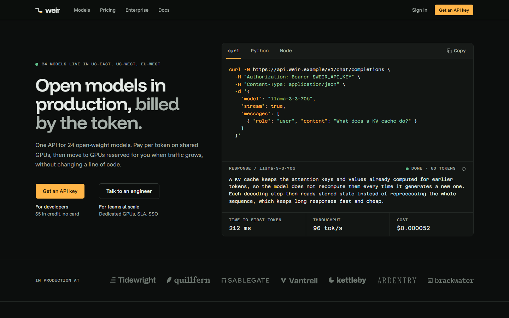
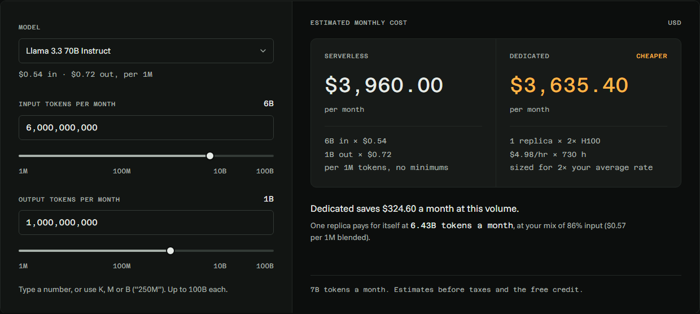
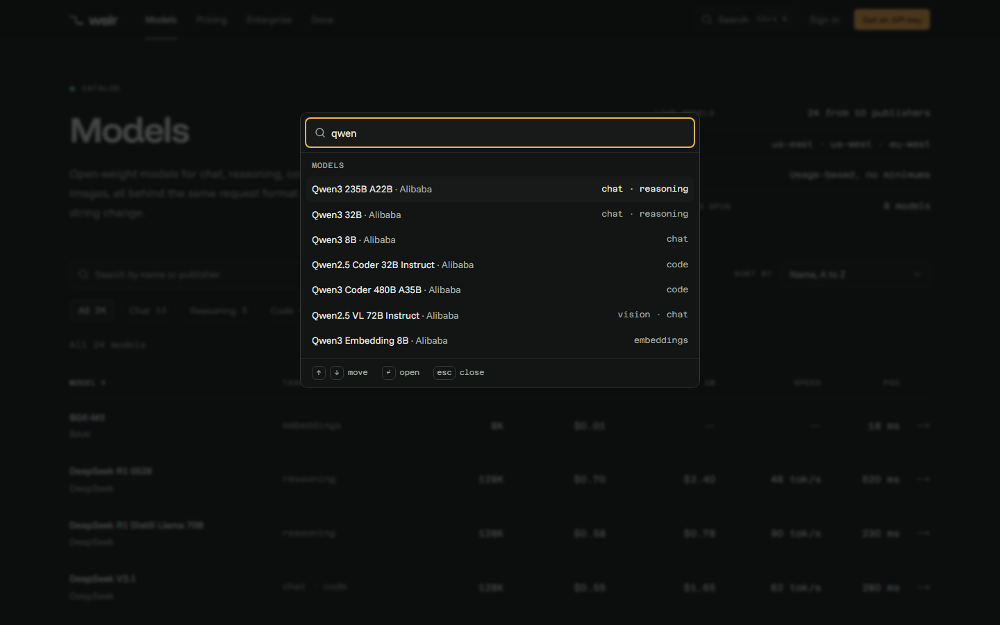
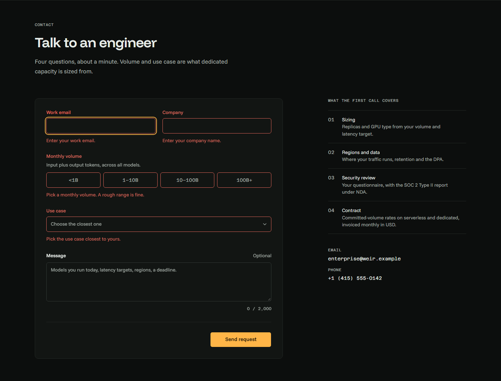
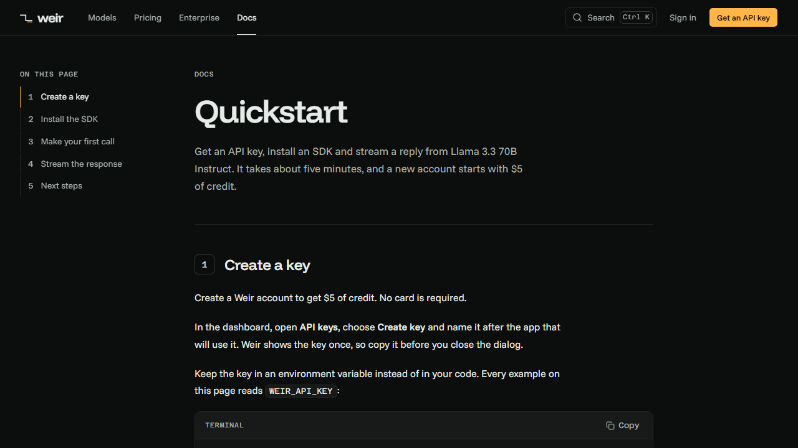
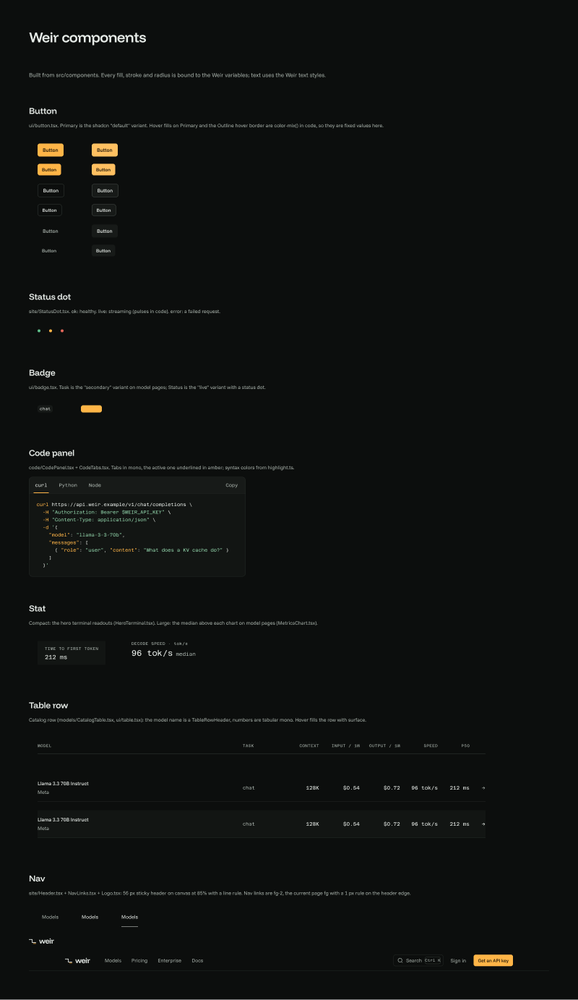

# Weir

Weir is a fictional AI-inference company in San Francisco. It serves open-weight models on shared GPUs, billed per token, and on dedicated GPUs, billed by the hour. This repository is its marketing site and docs.

It is a concept project. The company, its customers, prices, benchmarks and phone numbers are all invented. The domains end in `.example`, and nothing on the site can be bought or called. The footer of every page says so.



## Why it exists

Inference companies have a hard site to build: many models, prices that change with the model and the type of capacity, enterprise buyers who want SLAs and compliance answers, and an architecture worth explaining. Weir is my take on that brief. It is meant to read like a real product site whose numbers would hold up in a contract or a benchmark.

What to look for:

- **One source for every number.** Prices, latency, GPU rates, the SLA, regions and certifications live in `src/data/`. Every page, share image and meta description reads them from there, and an e2e test checks that a price reads the same on every page.
- **Pricing math that can't be broken from the UI.** The calculator clamps pasted text, negative numbers and `1e30` to 0–100B tokens. It never shows `NaN`, and it only claims a break-even volume that one replica can actually serve.
- **Fully static.** `next build` writes plain HTML, including the share images (`og.png` route handlers). The deploy is a zip with no server and no build step on the host.
- **Accessible by default.** Axe runs on every page, and with the menus and the tooltip open. The site works from the keyboard, forms link their errors to their fields, and with `prefers-reduced-motion` everything shows its final state at once.
- **Tested.** Vitest covers the math, the data and the form schema. Playwright runs the user flows on a desktop and a phone viewport.

## Screenshots

| | |
| --- | --- |
|  |  |
| Pricing calculator: serverless against one dedicated replica | Command menu (Ctrl K / ⌘K) across pages and models |
|  |  |
| Enterprise form: one message per field, focus on the first | Quickstart, written in MDX |

Pull requests with visual changes keep their screenshots in `docs/pr/<branch>/`.

## Design

The design system and the screens are in Figma: **https://www.figma.com/design/kOGHETj4K8DtaJiyTHReaz**

[`docs/figma.md`](docs/figma.md) maps each Figma page, component and variable to its source in the code. The code is the source of truth: the Figma variables mirror the tokens in `src/app/globals.css`.



## Stack

| | Why |
| --- | --- |
| **Next.js 16** (App Router, `output: 'export'`) | Server components render every page to HTML at build time, so the site ships as static files and needs no server. |
| **React 19** and **TypeScript** (strict) | Types tie the data files to every page that reads them, so a renamed field fails the build. |
| **Tailwind CSS v4** | Colors, type sizes and radii are CSS tokens in `globals.css`. A unit test rejects any arbitrary font size. |
| **shadcn/ui on Radix** (`radix-ui`) | Accessible dialog, select, tabs, slider, accordion, sheet and tooltip, restyled with the Weir tokens instead of the defaults. |
| **cmdk** | The command menu (through shadcn's `Command`). |
| **Motion** (`scroll`) | The scroll-linked request diagram on the home page, loaded after hydration. Other movement is CSS or React state. |
| **MDX** (`@next/mdx`, `remark-gfm`) | The quickstart is prose with live components in it. Its prices and model names come from the same data files as the rest of the site. |
| **react-hook-form** | Holds the contact form's state without re-rendering the whole form on every keystroke. |
| **zod** | The form's schema, the same one the unit tests check. It loads on the form's first use, not on page load. |
| **next/font** | Funnel Display, Funnel Sans and Azeret Mono, self-hosted at build time. |
| **lucide-react** | Icons. |
| **Vitest** | Unit tests for pricing math, formatters, data consistency, the form schema and the repo config. |
| **Playwright** and **axe-core** | End-to-end flows on desktop and phone viewports, plus accessibility checks on every page. |
| **GitHub Actions** | Lint, typecheck, unit tests, build and e2e on every pull request. |
| **archiver** | Zips the build for the Netlify deploy. |

## Folder map

```
.github/
  workflows/ci.yml            lint, typecheck, unit, build and e2e on every PR
  pull_request_template.md    What / Why / Screenshots / Testing
assets/fonts/                 fonts for the share images, with their OFL licenses
docs/
  figma.md                    the Figma file: pages, components, variables
  pr/<branch>/                screenshots linked from each pull request
public/
  _headers  _redirects        Netlify cache and security headers, the /docs/ redirect
  logos/                      marks of the invented customers
scripts/
  package.mjs                 build and zip for the Netlify deploy
  fix-segment-files.mjs       renames the prefetch files a Windows build gets wrong
  lighthouse.mjs              mobile Lighthouse on the main pages, median of 3 runs
src/
  app/                        routes: home, models, models/[slug], pricing, enterprise,
                              docs/quickstart (MDX), 404, sitemap, robots, og.png images
  components/
    code/                     code panel, tabs, copy button, highlighter, request snippets
    docs/                     docs layout, numbered steps, table of contents
    enterprise/               contact form, procurement tables
    home/                     hero terminal, request diagram, catalog preview, trust band
    models/                   catalog table and filters, specs, metrics chart
    pricing/                  calculator, price tables, FAQ
    site/                     header, mobile nav, footer, command menu
    ui/                       shadcn components, themed
  data/                       company facts, models, GPUs, customers, navigation
  lib/                        pricing math, formatters, catalog filters, metrics, metadata
  mdx-components.tsx
tests/
  unit/                       Vitest
  e2e/                        Playwright
```

## Running it

Requires **Node 22.18+ or 24.2+** (Node 23 and 24.0–24.1 lack `import.meta.main`); CI and `.nvmrc` use Node 24. The segment-file fix in the build needs `import.meta.main`, which older versions don't have.

```bash
npm install
npm run dev          # http://localhost:3000
```

| Script | What it does |
| --- | --- |
| `npm run dev` | Start the dev server. |
| `npm run build` | Build the static site into `out/`, then fix the prefetch file names a Windows build gets wrong. |
| `npm run lint` | ESLint. |
| `npm run typecheck` | Generate Next's route types and run `tsc`. |
| `npm test` | Unit tests (Vitest). |
| `npm run test:e2e` | End-to-end tests (Playwright) against `out/`, served on port 4190. Run `npm run build` first. The first time, install the browser with `npx playwright install chromium`. |
| `npm run package` | Build and zip `out/` into `dist/weir-<YYYY-MM-DD>.zip`. Needs `SITE_URL` (below). |
| `npm run lighthouse` | Lighthouse (mobile) on the six main pages of `out/`, median of 3 runs each. Run `npm run build` first. See [Performance](#performance). |

### Site address (`SITE_URL`)

Share images and canonical URLs must be absolute, so the build reads the public address from `SITE_URL` (`src/data/site.ts`, used as Next's `metadataBase`, and in `sitemap.xml` and `robots.txt`). Without it, the build falls back to the fictional `https://weir.example`, which is fine for local work and CI.

`npm run package` refuses to build the zip while `SITE_URL` is unset or still `https://weir.example`:

```bash
SITE_URL=https://your-site.netlify.app npm run package
```

In Windows PowerShell: `$env:SITE_URL = "https://your-site.netlify.app"; npm run package`.

### Performance

Build first, then run Lighthouse on the six main pages:

```bash
npm run build
npm run lighthouse                          # /, /models/, a model page, /pricing/, /enterprise/, /docs/quickstart/
npm run lighthouse -- /models/ /pricing/    # only these pages
```

In Git Bash, write the pages without the leading slash (`models/ pricing/`): Git Bash turns `/models/` into a Windows path before the script sees it.

The script serves `out/` on `127.0.0.1:4195` and runs Lighthouse 12 with its defaults: the mobile preset with simulated throttling, in a visible Chrome window. It runs each page three times, one run at a time, and prints the median of each category with the LCP element, the longest task and the top failing audits. It exits with 1 when a page's median performance is under 95. It is not part of CI, because a shared runner is too noisy to hold a score.

Local scores understate mobile performance. On `127.0.0.1` every script has arrived before the first paint, so Lighthouse counts all the JavaScript toward the largest paint. The reference numbers are taken on the deployed site and will be added here after the deploy.

## Deploying

The site is deployed by hand, as a zip, to Netlify:

1. `SITE_URL=https://<site>.netlify.app npm run package`
2. In Netlify: **Sites → Add new site → Deploy manually**, then drag `dist/weir-<date>.zip` onto the page.

Nothing runs on Netlify's side. `_headers` (a long cache for `/_next/static/*`, plus `nosniff`, Referrer-Policy, Permissions-Policy and framing protection) and `_redirects` sit at the root of the zip, and Netlify reads them from there.

Live site: TODO, added after the first deploy.

## How it was built

The site was built in small pull requests. Each one uses the template in [`.github/pull_request_template.md`](.github/pull_request_template.md): what changed, why, before and after screenshots, and how it was tested. CI ran on every one. The [closed pull requests](https://github.com/LFUrbano/weir/pulls?q=is%3Apr+is%3Aclosed) read as the build log.

I built it with Claude Code as a pair programmer, and the commits carry its `Co-Authored-By` trailer.

**Case study:** TODO, a link to the write-up on lfurbano.com once it is published.

## License

All rights reserved. The code is public to read as a portfolio piece, not licensed for reuse. The fonts in `assets/fonts/` are under the SIL Open Font License, and their license texts sit next to them.
